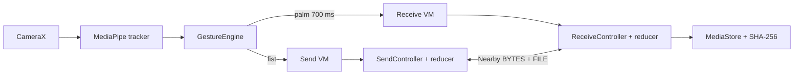

<div dir="rtl">

# كفّ · Kaff

**ارفع إيدك.. وانقل.** اختار الملف، اقبض عليه بيدك، وافتح كفّك قدام الجوال الثاني، والملف ينتقل.

<!-- GIF: two phones, fist on the left, open palm on the right (docs/DEMO_SCRIPT.md, shot 4–6) -->
`[ GIF placeholder: demo.gif ]`

## وش يسوي؟

- **قبضة = مسك الملف.** الكاميرا الأمامية تتعرف على قبضة يدك (MediaPipe على الجهاز نفسه)، والملف «يرتفع» بحركة ناعمة.
- **كف مفتوح = استلام.** الجوال الثاني يشوف كفّك المفتوح لمدة ٠٫٧ ثانية ويقبل الملف. زر «قبول» موجود دايماً.
- **نقل سريع بدون إنترنت** عبر Google Nearby Connections: بلوتوث للاتصال ثم واي فاي مباشر.
- **رمز اقتران من ٤ أرقام** يطلع في الجوالين، وما يوصل أي ملف قبل ما تأكد إن الرمز مطابق.
- **تحقق SHA-256** لكل ملف قبل الحفظ، والملف الناقص أو المتغيّر ما يُحفظ.
- صور وفيديو وأي ملف، وأكثر من ملف بنفس الوقت (حتى ٢٠).
- طرق تشغيل: زرين في الإعدادات السريعة، فقاعة عائمة، هز الجوال، ووضع استعداد بإشعار ثابت.
- مختبر إيماءات يعرض الهيكل والثقة وعدد الإطارات بشكل مباشر.
- عربي بالكامل من اليمين لليسار، والإنجليزية متوفرة. وضع داكن وفاتح، ويحترم «تقليل الحركة».

## حدود بصراحة

- **ما في كاميرا شغالة بالخلفية.** أندرويد يمنعها، فالكاميرا تشتغل بس وأنت فاتح الشاشة وتطفى لحالها.
- **أندرويد بس.** Nearby Connections ما تدعم iOS.
- **الإيماءة تشغيل، مو إثبات هوية.** الأمان من رمز الاقتران وزر القبول، مو من شكل اليد.
- لو التطبيق بالخلفية، يوصلك إشعار تضغط عليه. ما نفتح شاشات من نفسنا.
- أندرويد ٨ و٩: الملفات تنحفظ في مجلد التطبيق، لأننا ما نطلب إذن التخزين القديم.
- دقة الإيماءات تعتمد على الإضاءة والكاميرا. جرّبها في «مختبر الإيماءات» وعدّل الحساسية.

</div>

---

# Kaff (English)

**Raise your hand. Pass it on.** Pick a file, grab it with a fist, open your palm at the other
phone, and the file moves over a fast, offline, peer-to-peer link.

`[ GIF placeholder: demo.gif ]` · `[ Screenshot placeholders: home.png · send.png · receive.png · done.png ]`

## Features

| | |
|---|---|
| ✊ **Grab** | On-device hand tracking (MediaPipe HandLandmarker, GPU with CPU fallback) recognizes a fist; the file lifts off with a spring animation and particle trail. |
| 🖐 **Receive** | An open palm held for 0.7 s accepts. Accept and Decline buttons are always there. |
| 📡 **Offline transfer** | Google Nearby Connections, `P2P_POINT_TO_POINT` (Bluetooth bootstrap, then Wi-Fi Direct/hotspot). |
| 🔐 **Pairing** | Both phones show the same 4 digits. Nothing is accepted until the receiver confirms. |
| ✅ **Integrity** | SHA-256 and size are verified while saving; corrupted files never appear in the gallery. |
| 🗂 **Any file** | Photos, videos, documents; up to 20 per transfer. MediaStore saving with no storage permission. |
| ⚡ **Wake** | Send/Receive Quick Settings tiles, a floating bubble, shake to wake, and an opt-in Standby mode. |
| 🔋 **Power aware** | Camera auto-timeout, about 15 fps on battery saver, paused when the phone is hot. |
| 🧪 **Gesture Lab** | Live skeleton, raw and confirmed gesture, scores, handedness, palm facing, FPS. |
| 🌍 **Arabic first** | Full RTL Arabic UI with English, Tajawal type, dark and light themes, reduced-motion support, TalkBack labels. |

## Honest limitations

- **No always-on background camera.** Android does not allow it. The camera runs only while a
  transfer screen is visible and turns itself off after a timeout.
- **Android only.** Nearby Connections does not support iOS.
- **The gesture is a trigger, not an identity check.** Security comes from the pairing digits and
  the explicit Accept step, never from the shape of a hand.
- **Background offers need a tap.** Nearby cannot open the camera silently; Kaff posts a heads-up
  notification instead.
- **Android 8–9** save into the app's own folder, because Kaff does not request legacy storage
  permission.
- Gesture accuracy depends on light and camera quality; tune it in Settings and the Gesture Lab.
- Camera accuracy and over-the-air transfer were **not** verified on physical devices during
  development; see the checklist in [`docs/DECISIONS.md`](docs/DECISIONS.md#needs-device-testing).

## Architecture

MVVM + clean layers; transfer logic is a pair of pure state machines. Details in
[`docs/ARCHITECTURE.md`](docs/ARCHITECTURE.md), wire format in [`docs/PROTOCOL.md`](docs/PROTOCOL.md).



**Stack:** Kotlin 2.4 · Jetpack Compose + Material 3 · Navigation Compose · Hilt (KSP) ·
Coroutines/Flow · CameraX · MediaPipe Tasks Vision · Play Services Nearby · Room · DataStore ·
kotlinx.serialization · JUnit + MockK + Turbine.

## Setup

Requirements: Android Studio with JDK 21, Android SDK 37, two Android 8+ phones with Google Play
services.

```bash
git clone <repo> kaff && cd kaff
sh scripts/fetch_model.sh          # downloads hand_landmarker.task (7.8 MB) into app/src/main/assets
./gradlew assembleDebug            # or open in Android Studio and run
./gradlew testDebugUnitTest lint   # 104 JVM tests: gestures, protocol, both state machines, two-phone flow
./gradlew bundleRelease            # Play upload: per-ABI split, about 25 MB per phone
```

The model comes from Google's official MediaPipe storage and is not committed; the build fails
with a clear message if it is missing.

## Project layout

```
app/src/main/java/dev/kaff/app/
  core/          DI, launch targets, permissions, formatting
  domain/        gesture/ (classifier, debouncer), transfer/ (protocol, reducers, controllers)
  data/          MediaPipe tracker, Nearby transport, MediaStore, Room, DataStore, sensors
  presentation/  Home, Send, Receive, Done, Settings, Gesture Lab, History, Permissions
  ui/            theme tokens, components, animation
  service/       Standby, floating bubble, Quick Settings tiles, notifications
docs/            ARCHITECTURE, PROTOCOL, DECISIONS, DEMO_SCRIPT, LINKEDIN_POST
```

## License

MIT, see [LICENSE](LICENSE). Tajawal is under the SIL OFL 1.1; the MediaPipe model is Apache 2.0.
