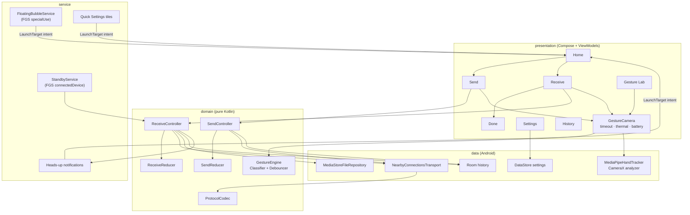

# Architecture

Kaff is a single-activity Compose app using MVVM with clean layers. Business rules live in plain
Kotlin (`domain`) and are unit-tested without Android. Android APIs stay in `data` and `service`.



## How a frame becomes a transfer

1. **CameraX** delivers RGBA frames (`KEEP_ONLY_LATEST`, about 640×480) to `MediaPipeHandTracker`
   on a single background thread. Each frame is rotated upright and mirrored for the front
   camera, then sent to `HandLandmarker.detectAsync` (LIVE_STREAM, GPU with CPU fallback). Every
   `ImageProxy` is closed via `use {}`.
2. Results become a `HandFrame` (21 landmarks, handedness, image size) and go to `GestureCamera`,
   which runs `GestureEngine` off the main thread.
3. `GestureClassifier` scores fist and open palm from scale- and rotation-invariant ratios.
   `GestureDebouncer` requires 6 stable frames with hysteresis and emits `justConfirmed` once.
4. The Send ViewModel turns a confirmed **fist** into `SendEvent.Grab`. The Receive ViewModel turns
   an **open palm held 700 ms** into `ReceiveEvent.Accept`.
5. `SendController` and `ReceiveController` feed events to the **reducers**:
   `(state, event) → (state, effects)`. Reducers are pure, with exhaustive `when` over every
   state, and are tested transition by transition. Controllers run the effects: Nearby calls,
   timers, file saves, haptics, history and notifications.

## Why reducers

The transfer has many interleaved inputs: radio callbacks, gestures, buttons, timers and file I/O.
A reducer keeps every rule in one readable place, makes illegal transitions impossible (an
`Accept` during pairing is simply ignored), and lets the whole two-phone flow run in a JVM test
through `FakeNearbyNetwork`.

## Lifecycles

- **Controllers** are process singletons, so Standby mode and the receive screen share one
  session and the radio is never driven by two owners.
- **Camera** is bound only while a ViewModel asks for it (an offer on screen, or files ready to
  grab), only in the foreground, and it times out. The tracker is closed in `onCleared`.
- **Radio:** leaving Send cancels the session (`stopAll`). Completion, failure and idle
  timeouts always disconnect. Standby restarts advertising once both roles are idle.

## Packages

```
core/          DI modules, LaunchTarget, permissions, formatting
domain/        model, gesture/, transfer/, repository interfaces
data/          hand/ (MediaPipe), nearby/, mediastore/, room/, datastore/, power/, sensors/, platform/
presentation/  home, send, receive, done, settings, lab, history, permissions, navigation, common
ui/            theme (tokens, Tajawal), components, animation
service/       Standby, floating bubble, Quick Settings tiles, notifications
```
